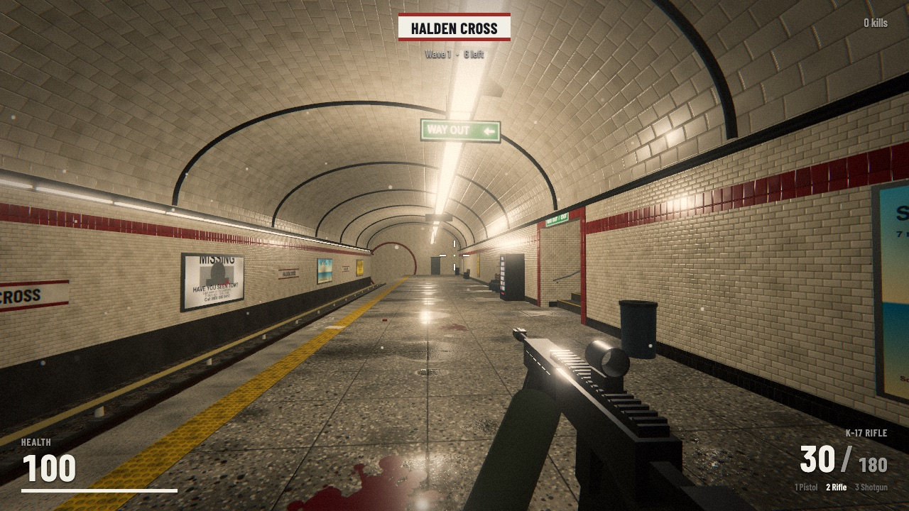
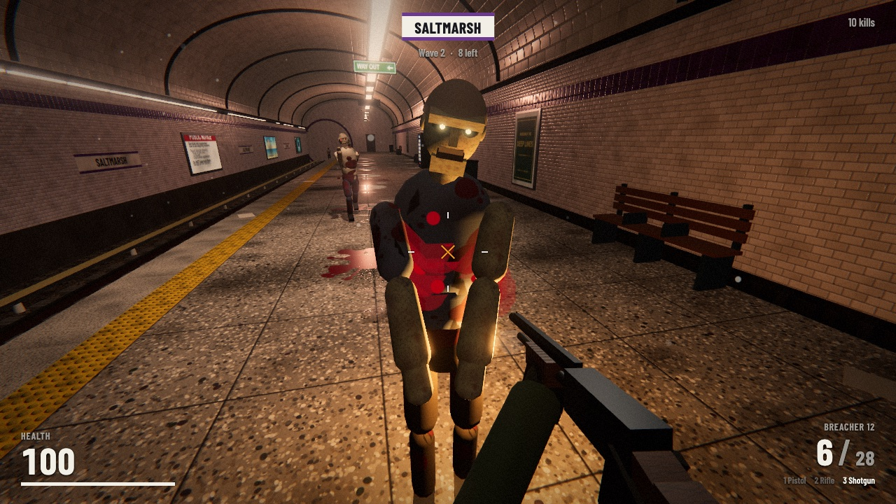
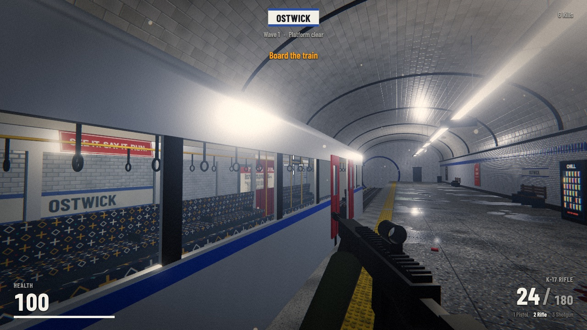
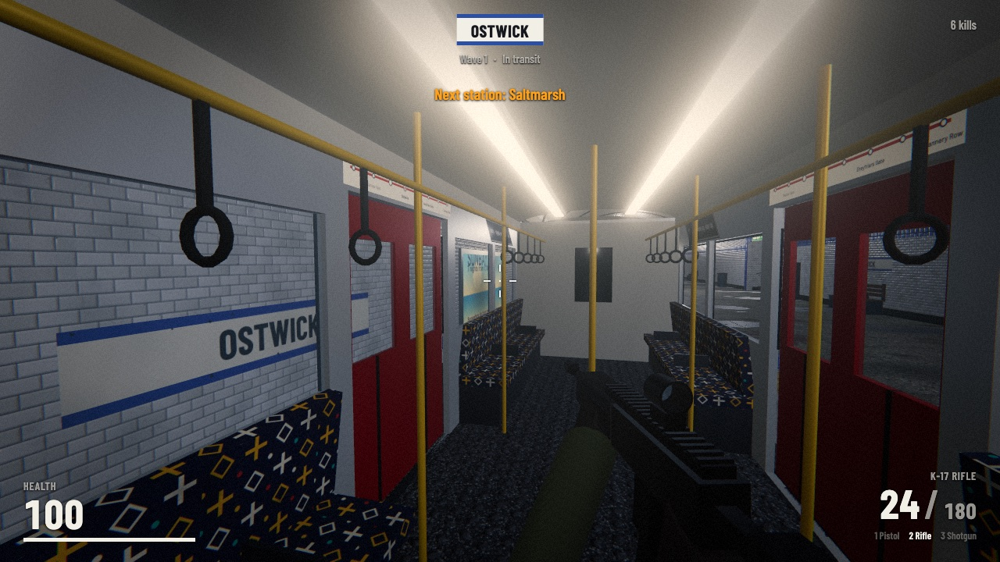
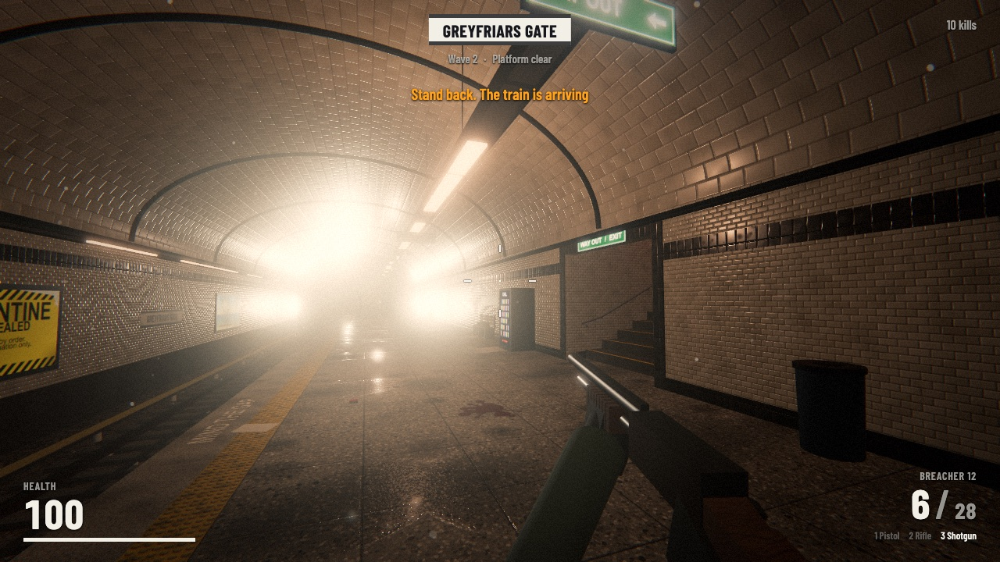

# Last Train Out

A browser FPS set in a deep-level subway station, built with Three.js. Every texture, model and sound is generated in code: there are no asset files.

Created with Claude Opus 5.5.



| | |
| --- | --- |
|  |  |
|  |  |

## Run

```sh
npm install
npm run dev
```

Open the printed URL and click **Enter the station**.

## Play

- `W A S D` move, `Shift` sprint, `Space` jump (or climb back onto the platform from the track)
- Mouse to aim, left button fires, right button aims down sights
- `R` reload, `1 2 3` or the mouse wheel to switch weapon
- `Esc` pauses

Hold the platform until the wave is clear. A train then arrives: get on it. The doors close, the train takes you through the tunnel to the next station, and the next wave starts when you step off. Each station is darker, more broken and busier than the last. Boarding the train refills your ammo and gives back 40 health.

Do not stand on the track when a train comes in.

## Weapons

| Weapon | Mag | Notes |
| --- | --- | --- |
| P9 Pistol | 12 | Semi-auto, accurate, slide locks back when empty |
| K-17 Rifle | 30 | Full auto, red-dot sight |
| Breacher 12 | 7 | Pump shotgun, 9 pellets, loads shell by shell |

## Enemies

- **Walkers**: slow, some limp, some reach.
- **Runners** (from wave 2): fast, red eyes, scream when they appear.
- **Brutes** (from wave 3): big and slow, take a lot of damage.

Head shots do the most damage. Enemies come down the stairs, along the tunnels (and climb onto the platform), and later through the staff doors.

## Code map

| File | Contents |
| --- | --- |
| `src/main.js` | Game loop, waves, train journey, shooting, pickups, HUD |
| `src/station.js` | Platform, vault, stairs, tunnels, props, lights, station themes |
| `src/train.js` | Three-car train with interior, sliding doors and colliders |
| `src/zombies.js` | Procedural humanoids, animation and AI |
| `src/weapons.js` | Weapon models, viewmodel animation, recoil, reload |
| `src/audio.js` | Web Audio synthesis and station reverb |
| `src/fx.js` | Particles, tracers, decals, casings |
| `src/textures.js` | Canvas-painted textures and normal maps |
| `src/world.js` | Collision and BVH ray queries |
| `src/renderer.js` | Renderer, bloom and the final grading pass |
